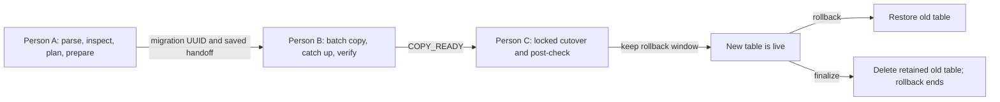

# SchemaMigrate

A learning-focused PostgreSQL project demonstrating a staged, online-style migration that adds one column to a table. The workflow is split into three project roles: **Person A plans and prepares**, **Person B copies and verifies**, and **Person C cuts over or rolls back**.

> **Scope:** This repository is a local educational prototype, not production-ready migration software. Its README uses production-style operating documentation, but the implementation has a deliberately narrow supported migration shape and has not been hardened for arbitrary production databases, workloads, or failure modes. Use only a disposable database for demonstrations.

## Contents

- [Project at a glance](#project-at-a-glance)
- [People, roles, and handoffs](#people-roles-and-handoffs)
- [Folder and file structure](#folder-and-file-structure)
- [Requirements](#requirements)
- [Start in VS Code](#start-in-vs-code)
- [Run the complete migration flow](#run-the-complete-migration-flow)
- [Test live writes during batch copying](#test-live-writes-during-batch-copying)
- [Test cutover and rollback](#test-cutover-and-rollback)
- [SQL checks in pgAdmin or psql](#sql-checks-in-pgadmin-or-psql)
- [Individual CLI commands](#individual-cli-commands)
- [Migration states](#migration-states)
- [Troubleshooting](#troubleshooting)
- [Tests and project limits](#tests-and-project-limits)

## Project at a glance

The demo uses a dedicated PostgreSQL database named `schemamigrate_demo` and a seeded table named `schemamigrate_demo.customers` with 1,000 rows and four original columns:

| Column | Type | Purpose |
|---|---|---|
| `id` | `integer` | Primary key and batch-copy cursor |
| `full_name` | `text` | Demo customer name |
| `email` | `text` | Unique demo email |
| `created_at` | `timestamp with time zone` | Demo creation time |

The example request adds `loyalty_level integer DEFAULT 1`. Person A creates a shadow table that includes this new column while the original table remains under the `customers` name. A PostgreSQL trigger records writes made to the source. Person B copies the existing rows and replays captured changes. Person C locks and swaps the tables, verifies the live table, then leaves a rollback window, rolls back, or finalizes.



## People, roles, and handoffs

“Person A,” “Person B,” and “Person C” are project assignment roles, not individual names. The **operator** is the person running the terminal and responding to confirmation prompts. A **database administrator** provides a PostgreSQL account for the isolated demo database. A **reviewer/demo observer** can inspect the plan, outputs, and database state in pgAdmin.

| Role | Responsibility | Receives / produces |
|---|---|---|
| Database administrator | Starts PostgreSQL and provides a role able to create the dedicated demo database. | Local PostgreSQL connection and credentials. |
| Operator | Opens the project in VS Code, configures DSNs, runs commands, reviews output, and confirms operations. | Runs commands and protects the demo database from accidental reset. |
| Person A — planner/preparer | Parses the requested change, inspects the source, evaluates risk, prepares the shadow and forward capture. | Produces a migration UUID, plan, shadow table, saved metadata, and Person B handoff. |
| Person B — copy/verification | Copies source rows in resumable batches, replays forward-captured writes, verifies source and shadow. | Produces `COPY_READY` status and a verification result for Person C. |
| Person C — cutover/rollback | Rechecks under locks, swaps table names, checks the live table, and handles rollback or finalization. | Produces `SWAPPED`, `ROLLED_BACK`, or a finalized state. |
| Reviewer / demo observer | Confirms the intended table, column, row count, captured writes, and final outcome. | Reviews terminal output and SQL results; does not need to run migration commands. |

The migration UUID is the handoff key between all three roles. Use the exact UUID printed by Person A in later commands. Do not type the placeholder text `MIGRATION_UUID` literally.

## Folder and file structure

```text
SchemaMigrate_Complete_Updated/
├── README.md                         # Project overview, roles, setup, runbook, checks, troubleshooting
├── MANUAL.md                         # Longer command-by-command guide
├── main.py                           # Shared CLI: run individual migration operations
├── mainA.py                          # Person A demo: parse → inspect/plan → prepare → handoff
├── mainB.py                          # Person B demo: copy batches → catch up → verify
├── mainC.py                          # Person C demo: cutover → post-check → keep/rollback/finalize
├── pyproject.toml                    # Package metadata, dependencies, Python requirement, CLI entry point
├── requirements.txt                  # Editable local install reference: -e .
├── schemamigrate/
│   ├── __init__.py                   # Marks schemamigrate as a Python package
│   ├── cli.py                        # Routes shared main.py commands to migration functions
│   ├── models.py                     # Shared MigrationRequest data model
│   ├── database.py                   # Password prompt, connections, PostgreSQL catalog inspection
│   ├── parser/
│   │   ├── __init__.py               # Marks parser as a Python subpackage
│   │   └── request_parser.py         # Person A: validate supported ALTER TABLE ADD COLUMN input
│   ├── planner.py                    # Person A: rules, findings, SAFE/RISKY/BLOCKED plan, estimates
│   ├── prepare.py                    # Person A: persist plan, create shadow, install forward capture
│   ├── handoff.py                    # Person A → B: save/read the migration handoff
│   ├── state.py                      # Shared migration status, copy progress, metadata access
│   ├── copy_engine.py                # Person B: keyset batches and forward/reverse event replay
│   ├── verification.py               # Person B: compare source/shadow counts and original columns
│   ├── cutover.py                    # Person C: locked swap, reverse capture, rollback
│   ├── lifecycle.py                  # Shared lifecycle; Person C uses abort/finalize operations
│   ├── sql_resources.py              # Resolve a named SQL statement into a psycopg SQL object
│   └── sql_templates.py              # Embedded SQL grouped by capture/state/copy/verify/cutover APIs
├── scripts/
│   └── create_demo_db.py             # Create/reset the dedicated demo schemas and seed 1,000 rows
└── tests/
    ├── __init__.py                   # Test package marker
    └── test_core.py                  # Unit tests for parser and planner rules
```

### File ownership and task description

| Person / area | File(s) | Task and connection to the workflow |
|---|---|---|
| Person A | `mainA.py` | One-command Person A demonstration. Calls parser, database inspection, planner, preparation, and handoff. Prompts before making database changes. |
| Person A | `schemamigrate/parser/request_parser.py` | Accepts the supported `ALTER TABLE ... ADD COLUMN` request and converts it to a `MigrationRequest`; rejects unsupported input. |
| Person A | `schemamigrate/planner.py` | Reads inspection facts and applies planning rules. Returns findings, status, estimated copy time, and estimated shadow disk use. |
| Person A | `schemamigrate/prepare.py` | Creates persistent migration state, shadow table and requested column, and installs a forward trigger on the original table. |
| Person A → Person B | `schemamigrate/handoff.py` | Saves and returns source/shadow names, original columns, primary key, row estimate, status, and other copy inputs. |
| Person B | `mainB.py` | Runs Person B’s full flow: read handoff, copy all batches, catch up forward events, verify, and report readiness. |
| Person B | `schemamigrate/copy_engine.py` | Implements resumable primary-key batches and replay of captured insert/update/delete events. The same engine supports reverse replay for Person C rollback. |
| Person B | `schemamigrate/verification.py` | Compares source and shadow row counts and original columns. The locked cutover performs a final comparison again. |
| Person C | `mainC.py` | Runs cutover and a post-cutover check; prompts to keep the rollback window, roll back, or finalize. |
| Person C | `schemamigrate/cutover.py` | Locks source/shadow, performs final catch-up and comparison, renames tables, installs reverse capture, and restores names on rollback. |
| Person C / shared lifecycle | `schemamigrate/lifecycle.py` | Removes a pre-cutover shadow on abort and removes the retained table after rollback/cutover on finalize. Finalize ends rollback availability. |
| Shared | `main.py`, `schemamigrate/cli.py` | General command-line interface for running plan, prepare, copy, catch-up, verify, handoff, status, cutover, rollback, abort, or finalize individually. |
| Shared | `schemamigrate/models.py` | Defines the request data model passed between parsing, planning, preparation, and handoff. |
| Shared | `schemamigrate/database.py` | Opens PostgreSQL connections and prompts for passwords; inspects columns, keys, indexes, constraints, triggers, RLS, partitioning, estimates, and size. Person A relies on inspection most directly. |
| Shared | `schemamigrate/state.py` | Reads/updates the migration record, status, copied-row count, and copy cursor stored in PostgreSQL. |
| Shared | `schemamigrate/sql_resources.py`, `schemamigrate/sql_templates.py` | Keep SQL operations organized by API in Python. There is no separate runtime `.sql` folder in this version. |
| Demo setup | `scripts/create_demo_db.py` | Creates the demo database if missing; recreates only the two project-owned schemas within it and seeds the 1,000-row table. It is not run automatically by migration commands. |
| Tests | `tests/test_core.py` | Checks parser and planner behavior without connecting to PostgreSQL. |
| Packaging | `pyproject.toml` | Declares Python version, dependencies (`psycopg`, `pglast`), package metadata, and `schemamigrate` command entry point. |
| Packaging | `requirements.txt` | Contains `-e .`; pip installs the local project and its `pyproject.toml` dependencies. |
| Documentation | `README.md`, `MANUAL.md` | README is the project map and runbook; MANUAL contains the longer walkthrough. |
| Repository hygiene | `.gitignore` | Excludes virtual environments, Python caches, `.env`, generated package metadata, and local OS metadata from Git. |

`__pycache__/` and `.pyc` files are generated by Python and are not project source. `.venv/` and generated `*.egg-info/` are local environment/build files and should not be committed.

## Requirements

- Python 3.11 or newer.
- A running local PostgreSQL server. PostgreSQL 18 is the version used in the demonstrated Mac setup.
- A PostgreSQL role with permission to create the dedicated demo database on first setup and create objects in it.
- VS Code is recommended for the walkthrough but is not required; commands work in a normal terminal.
- Internet access is required during initial package installation unless dependencies are already available.

Examples below use port `5433` and user `postgres`, based on the local setup used during the demonstration. Change host, port, database, and username to match your own local server. Do not place a real password in the DSN commands; the application prompts for it without echoing typed characters.

## Start in VS Code

### 1. Open the project and terminal

Open the `SchemaMigrate_Complete_Updated` folder in VS Code. Choose **Terminal → New Terminal**. All commands below should run from the project root—the folder containing `main.py`, `pyproject.toml`, and `schemamigrate/`.

```bash
cd ~/Downloads/schemaMigrate/SchemaMigrate_Complete_Updated
```

If the folder is elsewhere, change the path to its actual location.

### 2. Create and activate the virtual environment

```bash
python3 -m venv .venv
source .venv/bin/activate
python -m pip install --upgrade pip
python -m pip install -e .
```

Alternatively, install through the requirements file:

```bash
python -m pip install -r requirements.txt
```

`-e .` means “install the project in the current directory in editable mode.” It is a line in `requirements.txt`, not a terminal command to paste by itself. After installation, list available commands with:

```bash
python main.py --help
```

### 3. Confirm PostgreSQL is running

On macOS with the PostgreSQL 18 installer:

```bash
/Library/PostgreSQL/18/bin/pg_isready -h 127.0.0.1 -p 5433
```

Expected response:

```text
127.0.0.1:5433 - accepting connections
```

If the server uses another port, use that port in `pg_isready` and both DSNs below.

### 4. Configure the maintenance connection and initialize demo data

```bash
export SCHEMAMIGRATE_ADMIN_DSN='host=127.0.0.1 port=5433 dbname=postgres user=postgres'
python scripts/create_demo_db.py
```

Enter the PostgreSQL password when prompted. The script creates the `schemamigrate_demo` database if it does not exist. Every run then drops and recreates the project-owned `schemamigrate_demo` and `schemamigrate_meta_v1` schemas **inside that database**, and seeds 1,000 customers with four columns. This destroys data and objects in those two schemas. Use only the disposable demo database; do not point this at a database with data you need.

Set the application connection for the demo database:

```bash
export SCHEMAMIGRATE_DSN='host=127.0.0.1 port=5433 dbname=schemamigrate_demo user=postgres'
```

Migration commands prompt for the PostgreSQL password when they connect. The `export` commands apply to the current terminal session; repeat them in a new terminal.

## Run the complete migration flow

Use the same terminal session so the DSN variables stay set. Run each person's command in order. Save the migration UUID printed by Person A and use that exact UUID in all later commands.

### Person A — parse, inspect, plan, prepare, and hand off

```bash
python mainA.py --sql 'ALTER TABLE schemamigrate_demo.customers ADD COLUMN loyalty_level integer DEFAULT 1'
```

Person A prints a plan based on the actual table. A `BLOCKED` plan stops. A `SAFE` plan requires the exact confirmation `PREPARE` before it changes PostgreSQL objects. On success, the output includes:

- A migration UUID.
- The original source table (`schemamigrate_demo.customers`).
- A shadow table such as `schemamigrate_demo.sm_shadow_0123456789abcdef`.
- A persisted handoff for Person B.

At this stage, the original `customers` table remains live. The requested column is on the shadow. Save the UUID and full shadow-table name from the output.

### Person B — batch copy, catch up, and verify

Replace the example UUID below with Person A’s actual UUID:

```bash
python mainB.py MIGRATION_UUID
```

Person B copies rows in batches (default 1,000), applies captured forward events, and verifies. The expected clean-demo result is 1,000 copied rows, `verified: true`, and `COPY_READY`. To use smaller batches:

```bash
python mainB.py MIGRATION_UUID --batch-size 250
```

Person B’s script processes all batches in one run. For a live-write demonstration where you need to pause between batches, follow [Test live writes during batch copying](#test-live-writes-during-batch-copying) instead.

### Person C — cutover and post-migration check

```bash
python mainC.py MIGRATION_UUID
```

For a `COPY_READY` migration, type `CUTOVER` exactly. Person C locks the tables, performs final change replay and comparison, swaps the table names, and checks that the live table has the requested column. At the next prompt:

- Press **Enter** to keep the new table live and retain rollback availability.
- Type `ROLLBACK` and confirm `ROLLBACK` to restore the old table.
- Type `FINALIZE` and confirm `FINALIZE` to delete the retained old table and permanently end rollback availability.

Use `ROLLBACK` or `FINALIZE` only when intended. `FINALIZE` is irreversible for this migration because it removes the old table needed by rollback.

## Test live writes during batch copying

This demonstrates the capture trigger between committed batches. It does not pause a query while an individual batch statement is executing.

1. Complete Person A and save the UUID and shadow table name.
2. Copy one batch of 100 rows:

   ```bash
   python main.py copy MIGRATION_UUID --batch-size 100
   ```

   Expect `copied_this_batch: 100` and `copy_complete: false`.

3. While the original `customers` table is still live, run these statements in pgAdmin’s Query Tool connected to `schemamigrate_demo`:

   ```sql
   INSERT INTO schemamigrate_demo.customers (id, full_name, email, created_at)
   VALUES (0, 'Live insert during copy', 'live-insert@example.test', now());

   UPDATE schemamigrate_demo.customers
   SET full_name = 'Live update during copy'
   WHERE id = 1;

   DELETE FROM schemamigrate_demo.customers
   WHERE id = 2;
   ```

   ID `0` is behind the copy cursor after the first batch. The later keyset copy will not see that new row, so captured-event replay must add it to the shadow. The update and delete exercise events for rows already scanned.

4. Resume copying, apply captured events, and verify. Use the real UUID in each command:

   ```bash
   python main.py copy MIGRATION_UUID --batch-size 100 --all
   python main.py catch-up MIGRATION_UUID
   python main.py verify MIGRATION_UUID
   ```

   Expected: catch-up reports 3 applied events, and verification reports `verified: true`. The count remains 1,000 because the insert adds one row and the delete removes one; the update does not affect the count.

5. Compare the affected rows in source and shadow. Replace `SHADOW_TABLE` with the exact table identifier printed by Person A, for example `schemamigrate_demo.sm_shadow_0123456789abcdef`:

   ```sql
   SELECT 'source' AS table_name, id, full_name
   FROM schemamigrate_demo.customers
   WHERE id IN (0, 1, 2)

   UNION ALL

   SELECT 'shadow', id, full_name
   FROM schemamigrate_demo.sm_shadow_0123456789abcdef
   WHERE id IN (0, 1, 2)

   ORDER BY id, table_name;
   ```

   The example shadow name is illustrative; substitute your actual name. Both tables should show ID `0` with `Live insert during copy`, ID `1` with `Live update during copy`, and no ID `2`.

## Test cutover and rollback

For a complete rollback demonstration, finish Person A and B, then run `mainC.py MIGRATION_UUID`. Type `CUTOVER`; at the next prompt press **Enter** to keep the rollback window open. Make a write to the new live table after cutover:

```sql
UPDATE schemamigrate_demo.customers
SET full_name = 'Write after cutover'
WHERE id = 1;
```

Run Person C again with the same UUID:

```bash
python mainC.py MIGRATION_UUID
```

It reports that cutover is already complete. Type `ROLLBACK` and then confirm with `ROLLBACK`. The reverse-capture path should replay the post-cutover write before restoring the old table. Check the restored table:

```sql
SELECT count(*) FROM schemamigrate_demo.customers;
SELECT id, full_name FROM schemamigrate_demo.customers WHERE id = 1;
```

Expected: 1,000 rows, and ID 1 has `Write after cutover`. The migrated table is no longer live after rollback. The unused migrated table can be removed by running Person C again and selecting `FINALIZE`; this cleanup is optional for the demonstration.

To test finalization instead, start a separate clean demo run, complete cutover, and choose `FINALIZE` twice at the prompts. Do not finalize a migration you still want to roll back.

## SQL checks in pgAdmin or psql

Run queries in pgAdmin’s Query Tool connected to the `schemamigrate_demo` database, or connect with `psql`:

```bash
/Library/PostgreSQL/18/bin/psql -h 127.0.0.1 -p 5433 -U postgres -d schemamigrate_demo
```

### Confirm the seed table

```sql
SELECT count(*) AS customers FROM schemamigrate_demo.customers;
-- Expected immediately after demo setup: 1000

SELECT column_name, data_type
FROM information_schema.columns
WHERE table_schema = 'schemamigrate_demo'
  AND table_name = 'customers'
ORDER BY ordinal_position;
-- Expected before migration: id, full_name, email, created_at
```

### Check migration state and captured events

Replace the UUID with the actual migration UUID:

```sql
SELECT migration_id, status, copied_rows, copy_complete, old_table
FROM schemamigrate_meta_v1.migrations
WHERE migration_id = 'MIGRATION_UUID'::uuid;

SELECT direction, operation,
       count(*) AS captured_events,
       count(*) FILTER (WHERE processed) AS processed_events
FROM schemamigrate_meta_v1.change_events
WHERE migration_id = 'MIGRATION_UUID'::uuid
GROUP BY direction, operation
ORDER BY direction, operation;
```

### Check the live schema after cutover

```sql
SELECT count(*) AS live_rows,
       count(loyalty_level) AS rows_with_loyalty_level
FROM schemamigrate_demo.customers;
-- With DEFAULT 1 and the seeded demo: expected 1000 and 1000
```

### Check state after rollback or finalization

After rollback, `customers` should have the original four columns and status `ROLLED_BACK`. After finalization, status should be `FINALIZED`, `rollback_available` is false, and the retained old table has been removed. A finalized migration cannot be rolled back.

## Individual CLI commands

Use `python main.py --help` for current options. These examples assume `SCHEMAMIGRATE_DSN` is set and replace `MIGRATION_UUID` with the real UUID:

```bash
# Read-only inspection and plan
python main.py plan --sql 'ALTER TABLE schemamigrate_demo.customers ADD COLUMN loyalty_level integer DEFAULT 1'

# Prepare a shadow table (asks for PREPARE)
python main.py prepare --sql 'ALTER TABLE schemamigrate_demo.customers ADD COLUMN loyalty_level integer DEFAULT 1'

# Copy one batch, or all remaining batches
python main.py copy MIGRATION_UUID --batch-size 250
python main.py copy MIGRATION_UUID --batch-size 250 --all

# Replay, verify, inspect handoff, and inspect status
python main.py catch-up MIGRATION_UUID
python main.py verify MIGRATION_UUID
python main.py handoff MIGRATION_UUID
python main.py status MIGRATION_UUID

# Person C operations (confirmation required)
python main.py cutover MIGRATION_UUID
python main.py rollback MIGRATION_UUID
python main.py finalize MIGRATION_UUID

# Remove only a pre-cutover preparation
python main.py abort MIGRATION_UUID
```

`mainA.py`, `mainB.py`, and `mainC.py` combine these lower-level calls into person-specific flows. Prefer them for a demonstration; use `main.py` to inspect or run a stage separately.

## Migration states

| State | Meaning |
|---|---|
| `READY_FOR_COPY` | Person A prepared the shadow and capture; Person B can begin copying. |
| `COPYING` | One or more batches have committed; copying can resume using saved progress. |
| `COPY_READY` | Copy is complete; Person B’s verification passed and cutover can be attempted. |
| `SWAPPED` | Cutover completed; the new table is live and the old table is retained for rollback. |
| `ROLLED_BACK` | The old table name is restored as live; the new migrated table is retained until optional cleanup/finalize. |
| `FINALIZED` | The retained table was removed; rollback is no longer available. |
| `ABORTED` | A pre-cutover preparation was removed. |

## Troubleshooting

| Symptom | Cause | What to do |
|---|---|---|
| `pg_isready` says no response | PostgreSQL is stopped or the host/port is wrong. | Start the local PostgreSQL server and check the configured port. |
| `password authentication failed` | The password entered for that command did not match the PostgreSQL role. | Rerun the command and enter the correct password; the prompt hides typing. |
| `badly formed hexadecimal UUID` | The literal placeholder `MIGRATION_UUID` was typed, or the UUID was copied incorrectly. | Use the full UUID printed by Person A, including hyphens. |
| Plan says requested column already exists / `BLOCKED` | The migration has already been cut over, or the column was added by another run. | Do not rerun Person A for the same schema/table/column. Reset the disposable demo schemas only if starting a fresh demonstration. |
| `mainB.py` cannot continue | The migration was not prepared, the UUID is wrong, or the migration has already advanced to a later status. | Run `python main.py status MIGRATION_UUID` and follow the stage indicated by the state. Do not rerun Person B after cutover. |
| `FINALIZE` or `ROLLBACK` says no follow-up action | Prompt input was not an exact match, for example an extra escape sequence from an arrow key. | Type only the exact uppercase word, press Enter, then type it again at the confirmation prompt. |
| Rollback is unavailable | The migration was finalized and the retained old table was deleted. | Rollback cannot be recovered for that migration. Start a new disposable demo run if you need to test rollback. |
| Verification fails | Copy/catch-up is incomplete or data differs. | Do not cut over. Inspect status/events, rerun catch-up and verification, and investigate the mismatch. |

If the wrong action is entered at a Person C prompt, the script reports that it took no follow-up action. A `SWAPPED` migration then remains live with its rollback window open unless it was finalized.

## Tests and project limits

Run the parser and planner unit tests from the project root:

```bash
python -m unittest discover -s tests -v
```

These tests do not connect to PostgreSQL. The demo workflow is the database integration exercise and modifies the dedicated demo schemas.

Current implementation limits include:

- The parser supports a narrow `ALTER TABLE ... ADD COLUMN` request, not arbitrary SQL migration statements.
- The planner’s time and disk figures are rough estimates, not guarantees.
- The demo setup script resets the project-owned schemas inside `schemamigrate_demo`; inspect connection variables before running it.
- The demonstrated concurrent writes happen between committed batches. They do not model every possible transaction interleaving, long-running transaction, lock timeout, network failure, or crash-recovery condition.
- The project has not been validated for production scale, arbitrary table features, all PostgreSQL versions, high availability, or every operational/security requirement.

For the longer guided walkthrough, see [MANUAL.md](MANUAL.md).
